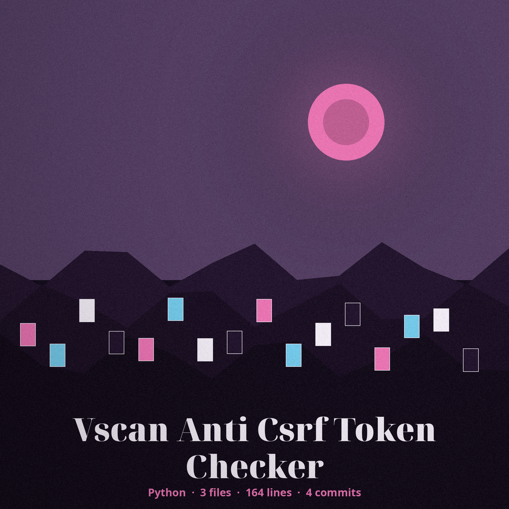
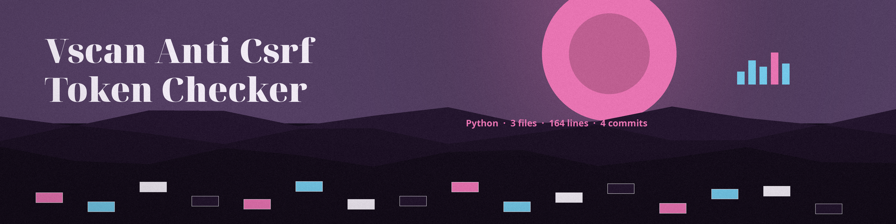

# vscan-anti-csrf-token-checker
Analyzes HTML forms to determine if anti-CSRF tokens are present and correctly implemented, identifying potential CSRF vulnerabilities. Focused on lightweight web application vulnerability scanning for common misconfigurations.

## Install
`git clone https://github.com/ShadowGuard-AI/vscan-anti-csrf-token-checker`

Then install dependencies: `pip install -r requirements.txt`

## Usage
`python3 main.py <url> [--verbose]`

Example: `python3 main.py http://127.0.0.1:8080/login`

## Parameters
- `url`: The URL of the page to analyze (positional, required)
- `-h`: Show help message and exit
- `--verbose`, `-v`: Enable verbose output (debug logging)

## Behavior
- GET forms are reported as not requiring a CSRF token, because GET is a safe method.
- A state-changing form counts as protected only when a hidden field whose name matches csrf, token, xsrf, or authenticity carries a non-empty value. Hidden field type matching is case-insensitive. Tokens delivered by script or headers are out of scope.
- If any state-changing form lacks a token, the tool logs a potential CSRF vulnerability warning for that form and exits 1 after checking all forms.
- If the page cannot be fetched, the tool logs a fetch failure and exits 1: a failed fetch is not a finding of no forms. A fetched page with no forms logs "No forms found on the page." and exits 0.

## License
MIT. See LICENSE.
